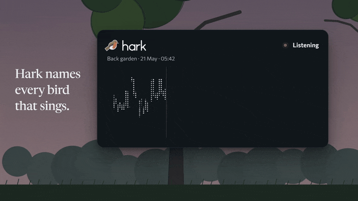

# Cinematic Film Kit

Describe a film to your coding agent. Get an MP4 back, with a score.

<a href="examples/hark/hark.mp4"></a>

<sub>Moments from **Hark**, the example: a 22-second launch film for a birdwatching app that doesn't exist. Every frame is drawn in code, every song is synthesised, and the robin's last nine notes become the nine strokes of the word "hark". [Watch it with sound](examples/hark/hark.mp4).</sub>

The kit turns a coding agent (Claude Code, Codex, Cursor and friends) into a small film crew. Remotion and WebGL draw the picture, a synthesiser writes the score, and a set of tools renders the result, pulls stills, and checks the film before anyone has to sit through a bad cut.

By default everything is made on your machine and nothing is paid for. Generated images, video, music and speech are an optional extra.

## What you'd say

> Make a 20 second launch film for my bakery, Crumb & Co. We bake sourdough overnight and you can order by 9pm for collection at 7am. Sound on. Here are our logo and colours.

> Make a 30 second product film for our scheduling app. Here are screenshots of the real screens it should show, and the three things it does better than a spreadsheet.

The agent writes a brief, pitches concepts and shows you style frames as stills. Once you're happy it renders, scores, masters and reviews the film, and hands over `out/<name>/<name>.mp4` with a short report.

Then give it notes the way you'd give an editor notes: what drags, what's unclear, what you love. Your reaction to the moving film is worth more than any automated check in here.

## Set up (about ten minutes)

You need about 5 GB free, **Node.js 22.18 or newer** and **ffmpeg**, on Windows 10 or 11, macOS 13 or newer, or Linux.

1. Install Node.js and ffmpeg:
   - **Windows** (PowerShell): `winget install OpenJS.NodeJS.LTS` and `winget install Gyan.FFmpeg`, then open a new terminal.
   - **macOS** ([Homebrew](https://brew.sh)): `brew install node ffmpeg`.
   - **Linux** (Debian or Ubuntu): `sudo apt install ffmpeg`, and Node 22 or newer from [nodejs.org](https://nodejs.org) or your package manager.
   - **Or Docker**, which needs nothing else: see `docker/README.md`.
2. Clone this repository or unzip a [release](https://github.com/fergo5002/cinematic-film-kit/releases).
3. Open the folder in your agent.
4. Say: **"Set this kit up and check it works."**

The agent runs `npm run doctor`, installs dependencies with `npm ci`, fetches Chrome Headless Shell (about 110 MB) and checks your graphics. To do it by hand:

```sh
npm ci
npx remotion browser ensure
npm run doctor
```

## Which agents

Any agent that can run commands on your machine. Everything it needs is in `AGENTS.md` and the skill in `.agents/skills/cinematic-film/`, and each agent finds its way there:

<details>
<summary>How each agent picks up the instructions (as of October 2026)</summary>

<br>

| Agent | What it reads | Anything to do |
|---|---|---|
| Claude Code | `CLAUDE.md`, which imports `AGENTS.md` | nothing |
| Codex CLI | `AGENTS.md`; skills in `.agents/skills` | nothing |
| Cursor | `AGENTS.md` | nothing |
| Gemini CLI | `GEMINI.md`, which imports `AGENTS.md` | nothing |
| GitHub Copilot (VS Code agent mode) | `AGENTS.md` and `.github/copilot-instructions.md` | nothing |
| Windsurf | `AGENTS.md` | nothing |
| Cline | `AGENTS.md` | make sure AGENTS.md support is on |
| OpenCode | `AGENTS.md` | nothing |
| Aider | `.aider.conf.yml`, which loads `AGENTS.md` and the skill | start `aider` from this folder |
| A chat model with no terminal | `CHAT.md` | upload it, then run the commands it gives you |

Agents change fast. If yours doesn't seem to have read the instructions, start the session with "Read AGENTS.md and follow it".

</details>

## Free, or with connectors

**Free** is the default. Everything is drawn and synthesised in code.

**Connectors** add paid generation (images, video, sound effects, music, speech) from fal, Replicate, ElevenLabs, OpenAI and Google, behind one command with a hard spending cap and a record of every file generated. Generated media is held to the same checks as drawn work. Set it up only if you want it: `connectors/README.md`.

## What's in the box

| Path | What |
|---|---|
| `AGENTS.md` | the operating manual every agent follows |
| `.agents/skills/cinematic-film/` | the craft: motion, structure, sound, type, colour, the checks, and the research behind them |
| `src/films/` | one folder per film; `hark` is the example, `template` is where new films start |
| `src/engine/`, `audio/` | shared drawing, shader and sound code |
| `tools/` | doctor, rendering, stills, contact sheets, the audit, the slop lint, review packets, release |
| `reviews/prompts/` | the cold explain-back and the critic |
| `connectors/` | optional paid generation, with mocks and tests |
| `docker/` | a Linux render box |
| `examples/hark/` | the example film and its review records |
| `docs/` | longer guides: per-agent notes, troubleshooting |

## Licences

The kit's own code and writing are MIT (`LICENSE`). Third-party software it installs keeps its own terms, listed in `THIRD_PARTY_NOTICES.md`.

One of those matters for business use. **Remotion**, the video engine, is free for individuals, companies of up to three employees, non-profits and evaluation. Bigger companies need a [Remotion company licence](https://www.remotion.dev/license). The bundled fonts are under the SIL Open Font Licence, which covers video.

## What has and hasn't been tested

Tested before release, on a 2023 Windows 11 laptop with integrated graphics and in a clean Linux container built from the zip: set-up, the template and the example film end to end, every tool's own test suite, and two independent code reviews whose findings were all fixed.

Not tested yet: a fresh agent making a film from this folder alone, macOS, and agents other than the ones I use (their instruction files follow each one's documentation). The connectors are tested against local mocks built from each provider's documentation, with the error replies that could only be guessed marked as guesses, because no keys were used. Details in `docs/testing.md`.

## Maintaining a release

Commit source changes, then run `python tools/package-source.py` (Python 3.11 or newer). Commit the generated `MANIFEST.json` before tagging. `python tools/package-source.py --check` compares the committed manifest with the committed source. The packager refuses dirty source and writes a ZIP and checksum under `dist/`. Python is only needed for this step.
